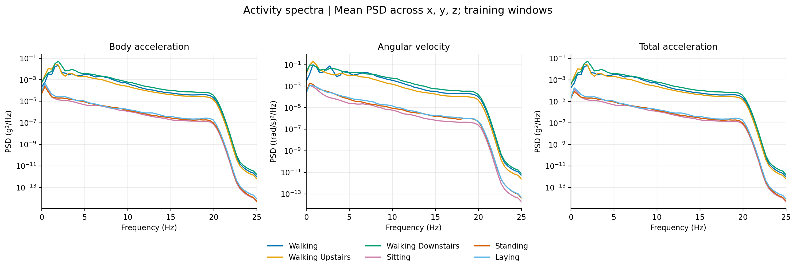
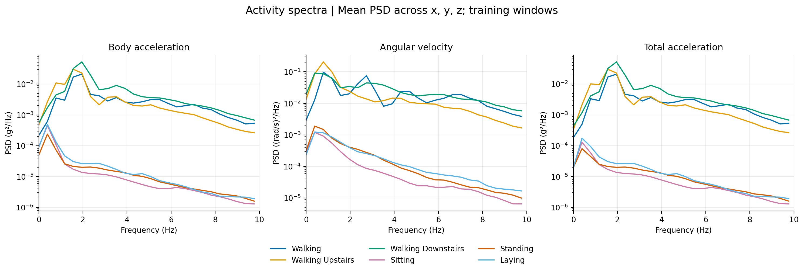
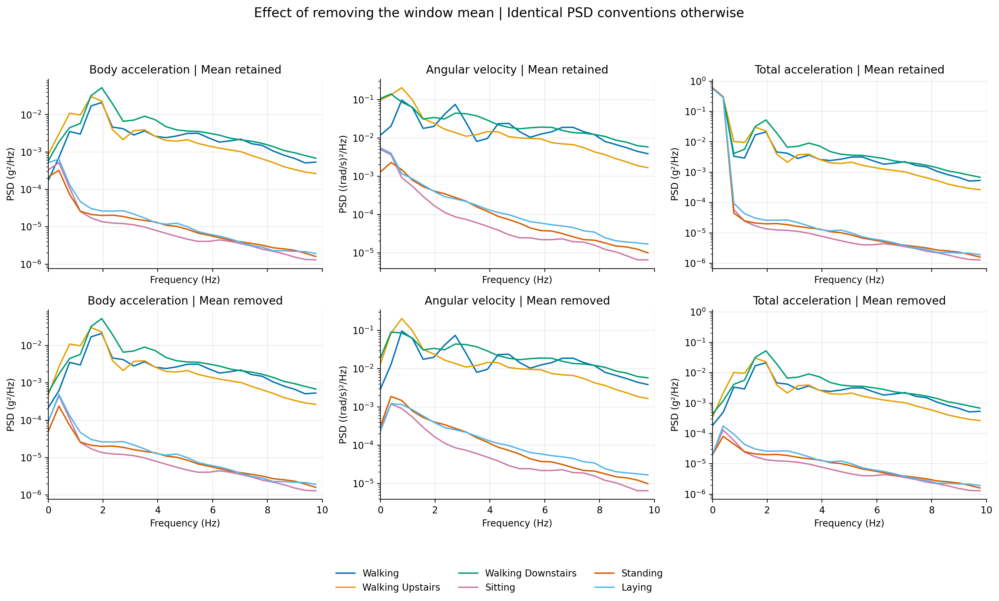
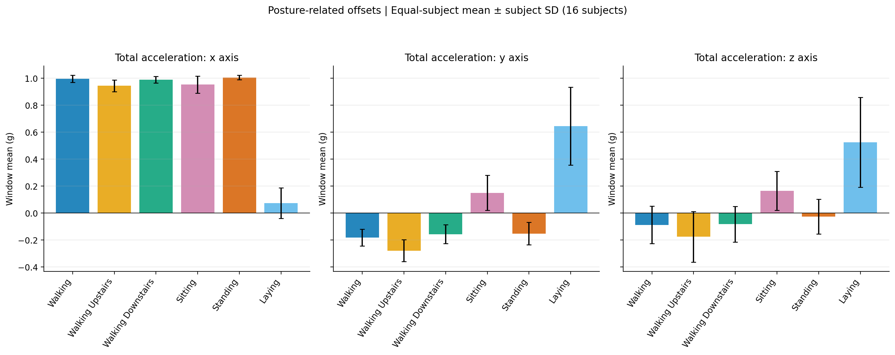
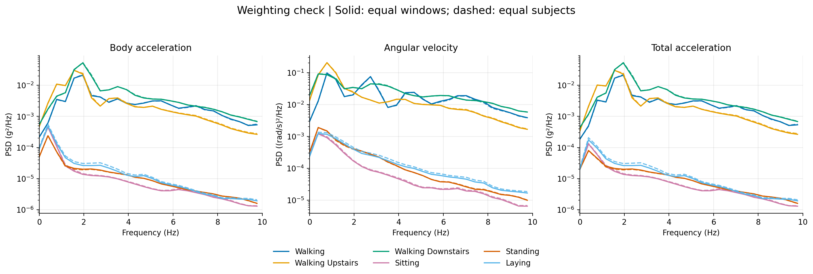

# Task 1.1 — HAR 활동별 스펙트럼 분석

실행일: 2026-10-24 (Asia/Seoul). 본 문서는 실제 실행 결과의 한국어 해설이다.

## 데이터와 방법

- 공식 HAR train에서 subject 기준 개발 분할을 적용한 training portion만 분석했다.
- 참가자 16명, 총 5,392개 윈도. Validation 1,960개와 공식 test는 분석하지 않았다.
- Train subjects: 1, 3, 5, 6, 7, 8, 11, 14, 15, 16, 19, 22, 23, 27, 28, 29.
- Validation subjects: 17, 21, 25, 26, 30. `split_seed=42`, `val_fraction=0.2`.
- 각 윈도는 50 Hz, 128 samples, 9 channels이며 길이는 2.56초이다.
- 학습용 z-score 또는 윈도별 분산 정규화를 적용하지 않은 센서 값을 사용했다.
- Starter의 `power_spectrum()`으로 각 윈도/채널의 시간축 PSD를 계산했다.
- Periodic Hann window, 윈도/채널별 시간 평균 제거, one-sided density scaling,
  NFFT=128, zero-padding 없음. 표시 범위 0–25 Hz, bin 간격 0.390625 Hz.
- PSD는 선형 값으로 평균한 뒤 로그 y축으로 표시했다. 시간 신호나 복소 FFT를 먼저 평균하지 않았다.
- 먼저 9채널을 개별 확인하고, 이후 같은 센서 그룹 내 x/y/z PSD를 산술평균했다.
  이는 3차원 벡터 크기 신호를 만든 뒤 FFT하는 연산과 다르다.
- 가속도 PSD 단위는 g²/Hz, 자이로 PSD 단위는 (rad/s)²/Hz이다.
  단위가 다른 두 센서의 power 크기를 직접 비교하거나 9채널 전체를 평균하지 않았다.
- 주 분석에서는 각 활동 내 모든 윈도를 동일 가중치로 평균했다.
  보조 분석에서는 참가자·활동 내 윈도 PSD를 평균한 뒤 참가자에 동일 가중치를 부여했다.
- Band power는 해당 PSD bin 합 × 0.390625 Hz로 계산했다.
  대역은 [0,3), [3,6), [6,12.5), [12.5,25] Hz이며 마지막 대역은 Nyquist bin을 포함한다.
  경계가 FFT bin과 일치하지 않는 경우가 있어 연속 대역 적분의 이산 근사이다.
- 평균 제거 전 PSD도 동일한 Hann/scaling으로 계산했다. 원본 채널 평균은 별도로 보존했다.

| 활동 | Train 윈도 수 | 참가자 수 |
|---|---:|---:|
| WALKING | 915 | 16 |
| WALKING_UPSTAIRS | 793 | 16 |
| WALKING_DOWNSTAIRS | 725 | 16 |
| SITTING | 932 | 16 |
| STANDING | 1,000 | 16 |
| LAYING | 1,027 | 16 |

## 1. 움직이는 활동과 정적인 자세의 차이



Body acceleration의 Hann-weighted centered power는 걷기 0.03631,
올라가기 0.04359, 내려가기 0.07300 g²였다. 정적인 자세에서는 앉기 0.0003213,
서기 0.0002340, 눕기 0.0003972 g²로 훨씬 작았다.
따라서 이 train 집합에서는 움직이는 세 활동과 정적인 세 자세가 동적 power에서 뚜렷하게 구분된다.
여기서 power는 Hann-weighted PSD 적분이며 원신호의 단순 비가중 분산과 정확히 같지는 않다.

내려가기는 body acceleration 총 power가 걷기의 약 2.01배였다.
하강 동작의 충격 등과 양립하는 관측이지만, 스펙트럼만으로 원인을 확정할 수는 없다.
세 동적 활동의 스펙트럼은 서로 겹치므로 단일 피크나 총 power만으로 완벽히 분류된다고 결론내리지 않는다.

## 2. 활동별 주요 대역



아래는 x/y/z 평균 body acceleration의 결과다. Peak는 DC를 제외한 가장 큰 PSD bin이다.

| 활동 | 비영 peak (Hz) | 0–3 Hz (%) | 3–6 Hz (%) | 6–12.5 Hz (%) | 12.5–25 Hz (%) |
|---|---:|---:|---:|---:|---:|
| WALKING | 1.9531 | 58.62 | 24.71 | 15.42 | 1.25 |
| WALKING_UPSTAIRS | 1.5625 | 74.89 | 17.55 | 6.83 | 0.73 |
| WALKING_DOWNSTAIRS | 1.9531 | 66.30 | 22.83 | 9.78 | 1.09 |
| SITTING | 0.3906 | 89.19 | 6.57 | 3.73 | 0.50 |
| STANDING | 0.3906 | 78.35 | 14.50 | 6.23 | 0.92 |
| LAYING | 0.3906 | 85.69 | 9.81 | 3.75 | 0.75 |

걷기와 내려가기의 주요 acceleration peak는 약 1.95 Hz, 올라가기는 약 1.56 Hz였다.
주기적인 움직임을 반영하는 관측으로 해석할 수 있지만, 평균 PSD의 최대 bin을
곧바로 개인별 보행 cadence나 stride frequency라고 단정하지 않는다.
Harmonic, 축별 반응, 개인별 속도 차이가 함께 섞여 있다.

자이로 그룹의 최대 비영 peak는 걷기/올라가기에서 0.78125 Hz,
내려가기에서 0.390625 Hz로 acceleration과 달랐다.
센서가 측정하는 물리량이 다르므로 모든 채널에 하나의 대표 주파수를 부여하는 것은 부적절하다.
정적 활동의 0.390625 Hz peak는 첫 번째 비영 FFT bin이다.
이것만으로 정적인 자세에 정확히 0.39 Hz 주기 운동이 있다고 해석할 수 없다.

## 3. HAR 전처리와의 연결

데이터의 README와 features_info에는 median filter와 20 Hz third-order Butterworth
low-pass 처리, 0.3 Hz 기준 body/gravity 분리가 설명되어 있다.
실제 곡선에서 약 20 Hz 이후 power가 급격히 낮아지는 것은 기존 전처리와 일관된다.
이를 인간 움직임 자체의 보편적인 20 Hz 한계라고 해석해서는 안 된다.

평균 제거 후 body acceleration과 total acceleration의 동적 PSD는 상당히 유사했다.
이는 두 채널 그룹 차이의 중요한 부분이 중력 등 저주파/평균 성분에 있다는 설명과 양립한다.
다만 평균 제거가 데이터셋의 0.3 Hz 필터와 같은 연산은 아니다.
이번 bin 간격은 0.390625 Hz이므로 0.3 Hz cutoff를 정밀하게 분해할 수도 없다.

## 4. 자세 정보는 DC 성분에도 있다





Total acceleration의 참가자 동일 가중 평균은 다음과 같았다.

| 활동 | x 평균 (g) | y 평균 (g) | z 평균 (g) |
|---|---:|---:|---:|
| SITTING | 0.953 | 0.150 | 0.165 |
| STANDING | 1.006 | -0.152 | -0.026 |
| LAYING | 0.074 | 0.645 | 0.525 |

눕기에서는 x축 평균이 감소하고 y/z축 평균이 커져 중력의 축별 투영이 바뀌는 자세 차이와 일관된다.
앉기와 서기도 특히 y축 평균에 차이가 보인다.
따라서 평균 제거 후 PSD만으로 정적인 활동을 비교하면 중요한 자세 정보를 놓칠 수 있다.
이 결과는 descriptive comparison이며 이 평균값만으로 모든 사람을 정확히 분류한다는 검증은 아니다.

막대의 error bar는 참가자별 평균에 대한 sample SD이다. 표준오차나 신뢰구간이 아니다.
평균 제거를 해도 Hann window를 곱한 신호의 가중합이 정확히 0이 되는 것은 아니므로,
centered PSD의 0 Hz bin이 반드시 0일 필요는 없다.
반대로 평균 제거 전에는 상수 성분도 Hann window의 영향으로 이웃 bin에 퍼질 수 있다.

## 5. 참가자 가중치에 대한 확인



6개 활동 × 3개 센서 그룹의 18개 조합 모두에서 최대 비영 peak bin이 유지됐다.
정규화된 spectral mass의 total variation distance는 약 0.0034–0.0134였다.
즉 분포 형태는 두 가중 방식에서 유사했다.

총 power는 일부 달랐다. 특히 눕기는 참가자 동일 가중치에서
body acceleration 약 13.5%, 자이로 약 13.0%, total acceleration 약 15.1% 증가했다.
따라서 참가자 가중치가 전혀 영향을 주지 않는다고 말하지 않고,
관찰한 주요 피크와 동적/정적 활동 구분이 유지됐다고 보고한다.

## 6. Task 1.2로 이어지는 관측

평균 제거 후 12.5–25 Hz power 비중은 전체 활동·센서 그룹에서 약 0.36–1.63%였다.
이는 50→25 Hz 다운샘플링 시 제거되거나 접힐 수 있는 고주파 에너지가 상대적으로 작다는 근거다.
따라서 naive와 anti-aliasing 차이가 작을 수 있다고 예상할 수 있다.
다만 이것이 aliasing 부재 또는 분류 성능 보존을 입증하지는 않는다.
실제 다운샘플링 비교는 Task 1.2에서 별도로 수행해야 한다.

## 해석의 범위와 검증

- 이번 분석은 training portion에 대한 기술통계이다. Validation/test 일반화 성능을 측정하지 않았다.
- HAR 윈도는 50% overlap하므로 5,392개를 독립적인 실험 반복으로 간주하지 않는다.
- 학습이나 확률적 실험이 없는 고정 데이터 분석이므로 동일한 FFT를 3 seeds로 반복하지 않았다.
  모델 성능의 3-seed 평균±SD 요구사항은 이후 학습 실험에서 충족해야 한다.
- Hann-weighted 시간영역 power와 PSD 적분의 최대 절대 오차는 약 3.55×10⁻¹⁵였다.
- 선택된 train/validation subject가 겹치지 않으며, 모든 train subject에 6개 활동이 존재함을 확인했다.
- 전체 9개 채널 그림도 확인했으며 그룹 평균만으로 해석하지 않았다.

## 산출물과 재현

원본 데이터·모델·신호처리 함수는 변경하지 않았다. 분석용 코드는
[examples/task11_spectra.py](../../examples/task11_spectra.py)에 추가했다.

```bash
conda activate dday
cd /home/swyoon/mamba_starter
python -m examples.task11_spectra --channel_xmax 35 --out runs/task11_reproduction
```

이 분석은 CPU 기반 FFT이며 GPU가 필요하지 않다.
기존 결과를 명시적으로 갱신하려면 기본 경로에서 `--overwrite`를 사용한다.

- `01_channel_psd`: 9채널별 PSD. 표시 x축은 35 Hz까지 확장했다.
  독립적인 one-sided PSD는 Nyquist 주파수인 25 Hz까지이다.
  25–35 Hz의 회색 영역에는 50−f 위치의 PSD를 반사해 점선으로 표시했다.
  이는 정규화를 유지한 시각적 복제이며, 새로 측정한 고주파 성분이나 대역 power가 아니다.
  이 점선은 모든 수치 집계에서 제외했다. Nyquist 경계를 유지하고 20 Hz low-pass filter와
  그 이후의 뚜렷한 감소를 주석으로 표시했다. `Significant drop`은 시각적인 감소를 뜻하며
  통계적 유의성 검정 결과를 뜻하지 않는다.
- `02_group_psd`: 그룹별 0–25 Hz PSD.
- `03_group_psd_low_frequency`: 그룹별 0–10 Hz 확대.
- `04_mean_removal_comparison`: 평균 제거 전후 비교.
- `05_posture_offsets`: total acceleration 평균과 참가자 SD.
- `06_subject_weighting_check`: 윈도/참가자 동일 가중 평균 비교.
- 각 그림은 PNG와 PDF로 저장했다.
- `spectral_metrics.csv`: 두 가중 방식의 9채널·3그룹별 power, peak, band 비중.
- `activity_subject_counts.csv`, `channel_means.csv`, `weighting_robustness.csv`: 보조 수치.
- `spectra.npz`: 주파수축, 활동별·참가자별 PSD 배열.
- `analysis_config.json`: 전체 설정, 분할 인덱스, 버전, 입력 파일 및 스크립트 SHA-256.
- `summary.json`: 주요 수치 요약.

데이터 출처와 전처리 설명:
[HAR README](../../data/har/UCI%20HAR%20Dataset/README.txt),
[HAR features_info](../../data/har/UCI%20HAR%20Dataset/features_info.txt).
